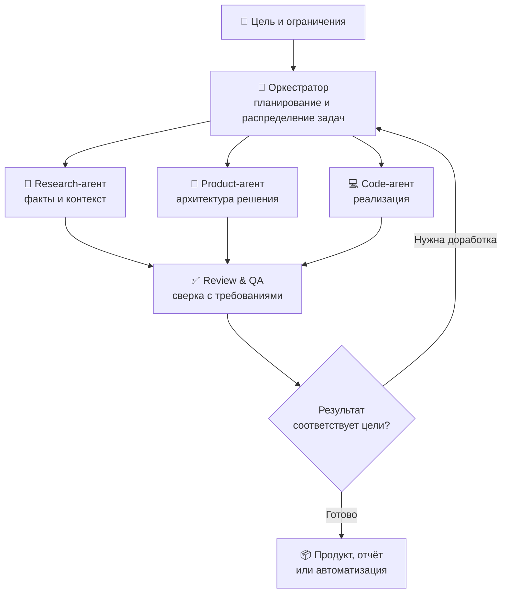

<div align="center">
  

  <h1>Привет, я Василий 👋</h1>
  <h3>Проектирую цифровые продукты на стыке архитектуры, технологий и искусственного интеллекта</h3>

  <p>
    <strong>От идеи и первого промпта — до сайта, автоматизации и мультиагентной системы.</strong><br/>
    Я отвечаю за замысел, архитектуру и результат. AI помогает превращать их в работающий код.
  </p>

  <p>
    
    
    
  </p>
</div>

---

## 🧭 Обо мне

Я архитектор с 30-летним опытом проектирования сложных объектов. Сегодня применяю то же системное мышление в разработке цифровых продуктов: **начинаю не с кода, а с цели, контекста, ограничений и архитектуры решения**.

Моя зона интересов — **вайбкодинг полного цикла**. Я создаю проекты в диалоге с AI: от небольших сайтов и персональных инструментов до автоматизированных рабочих процессов и систем, в которых несколько AI-агентов решают разные части одной задачи.

> **Вайбкодинг для меня — не кнопка «сделай всё».**  
> Это новый формат работы создателя продукта: человек задаёт направление и критерии качества, AI ускоряет проектирование, разработку, тестирование и документирование.

Мне особенно интересны задачи, где технологии дают измеримый практический эффект:

- сокращают время на повторяющуюся работу;
- объединяют разрозненные инструменты в единый процесс;
- превращают знания и опыт в цифровой продукт;
- помогают быстрее проверять идеи и запускать MVP;
- делают сложные процессы понятными и управляемыми.

---

## 🚀 Что я создаю

### 🌐 Веб-продукты и сайты

Создаю не просто страницы, а цельные цифровые сценарии — от структуры и пользовательского опыта до интеграций и публикации:

- персональные сайты, портфолио и лендинги;
- интерактивные визитки и презентационные страницы;
- веб-приложения и панели управления;
- формы, каталоги, фильтры и личные кабинеты;
- интеграции с API, базами данных и внешними сервисами;
- адаптивные интерфейсы для компьютеров и мобильных устройств.

**Фокус:** ясная идея, аккуратный интерфейс, быстрая проверка гипотезы и удобство дальнейшего развития.

### 🤖 AI-ассистенты и интеллектуальная автоматизация

Проектирую инструменты, которые встраивают возможности языковых моделей в повседневные процессы:

- ассистенты для работы с документами и знаниями;
- чат-боты и персональные помощники;
- обработка, классификация и структурирование информации;
- генерация текстов, изображений и других материалов;
- поиск данных и подготовка аналитических выводов;
- автоматическое ведение отчётности и контроль выполнения задач.

**Фокус:** AI должен не эффектно выглядеть в демо, а экономить время и давать проверяемый результат.

### 🔄 Контентные и операционные пайплайны

Собираю сквозные процессы, в которых отдельные действия связаны в единую управляемую цепочку:

```text
Источник → Отбор → Анализ → Создание контента → Проверка → Публикация → Отчёт
```

Такой подход применим не только к контенту: похожим образом можно организовать обработку заявок, подготовку документов, мониторинг информации и внутренние исследования.

**Фокус:** прозрачность каждого шага, контроль качества и возможность остановить или изменить процесс.

### 📊 Аналитические и финансовые инструменты

Развиваю цифровые инструменты для исследования данных и поддержки решений:

- сбор и визуализация данных;
- аналитические панели и информационные экраны;
- сценарный анализ и тестирование стратегий;
- журналы решений и контроль рисков;
- исследование алгоритмической торговли через бэктесты и песочницы.

**Фокус:** сначала проверка логики и рисков, затем автоматизация. Никаких обещаний доходности и решений «вслепую».

### 🧠 Мультиагентные системы

Проектирую системы, где сложная задача распределяется между специализированными агентами: один исследует, другой проектирует, третий пишет код, четвёртый проверяет результат.



**Ключевые элементы таких систем:**

- **Оркестратор** — разбивает цель на задачи и управляет последовательностью работы.
- **Специализированные агенты** — выполняют ограниченные роли вместо одного универсального «мастера на всё».
- **Инструменты и API** — подключают агентов к файлам, данным и внешним сервисам.
- **Контекст и память** — сохраняют важные решения и позволяют продолжать работу без потери смысла.
- **Quality Gate** — проверяет результат перед передачей пользователю.
- **Human-in-the-loop** — оставляет ключевые и необратимые решения за человеком.

---

## 🏗️ Как я работаю над проектом

| Этап | Что происходит | Результат |
|---|---|---|
| **1. Смысл** | Формулирую задачу, аудиторию, ограничения и критерий успеха | Понятная цель |
| **2. Архитектура** | Разделяю продукт на компоненты, выбираю процесс и инструменты | План реализации |
| **3. Прототип** | Быстро собираю работающий вертикальный срез продукта | MVP для проверки |
| **4. Итерации** | Тестирую сценарии, нахожу слабые места, уточняю решение | Устойчивая версия |
| **5. Контроль** | Проверяю код, данные, ошибки и соответствие исходной задаче | Проверяемое качество |
| **6. Передача** | Документирую запуск, структуру и дальнейшие шаги | Понятный продукт |

Мой принцип: **сначала заставить продукт решать одну реальную задачу хорошо, затем расширять возможности.**

---

## 🛠️ Технологии и инструменты

<div align="center">


</div>

**AI и агентная разработка:** Claude Code · LLM API · MCP · Prompt Design · RAG · Agent Orchestration · Tool Use · Human-in-the-loop

**Продуктовая работа:** UX/UI · Информационная архитектура · Прототипирование · API-интеграции · Автоматизация · Документирование

---

## 🧩 Мои принципы вайбкодинга

✅ **Человек отвечает за замысел и решения.** AI усиливает создателя, но не заменяет ответственность.  
✅ **Архитектура раньше кода.** Сначала понятная структура, потом скорость генерации.  
✅ **Работающий результат важнее эффектной демонстрации.** Каждый проект должен решать конкретную задачу.  
✅ **Качество проверяется.** Тесты, ревью, обработка ошибок и понятная документация — часть продукта.  
✅ **Безопасность встроена в процесс.** Минимальные доступы, защита секретов, контроль действий и конфиденциальность данных.  
✅ **Маленькие итерации вместо гигантского скачка.** Быстрый MVP → обратная связь → осознанное развитие.  
✅ **Технологии служат человеку.** Автоматизировать стоит то, что действительно освобождает время и внимание.

---

## 🎯 Сейчас в фокусе

- развитие мультиагентных систем с понятной оркестрацией и контролем качества;
- создание AI-продуктов полного цикла — от интерфейса до автоматизации;
- превращение профессионального опыта в полезные цифровые инструменты;
- исследование новых моделей взаимодействия человека и AI;
- развитие подхода, при котором сложный продукт можно создавать быстро, но не хаотично.

---

## 🤝 Что мне интересно

Буду рад обмену опытом и совместным экспериментам в темах:

- AI-продуктов и агентных систем;
- вайбкодинга как новой дисциплины создания продуктов;
- автоматизации интеллектуальной работы;
- цифровых инструментов для архитектуры, дизайна и городской среды;
- необычных проектов, где нужны одновременно системное мышление и быстрая реализация.

Если у вас есть идея, вопрос по одному из проектов или предложение для эксперимента — открывайте **Issue** в соответствующем репозитории.

---

<div align="center">

### «Хорошая архитектура — в здании или в коде — превращает сложность в понятную систему»

**Проектирую. Экспериментирую. Проверяю. Улучшаю.**


</div>
